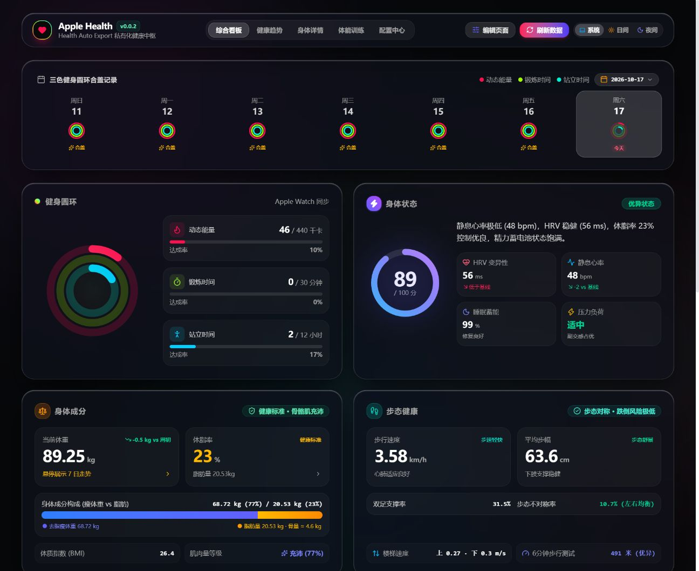
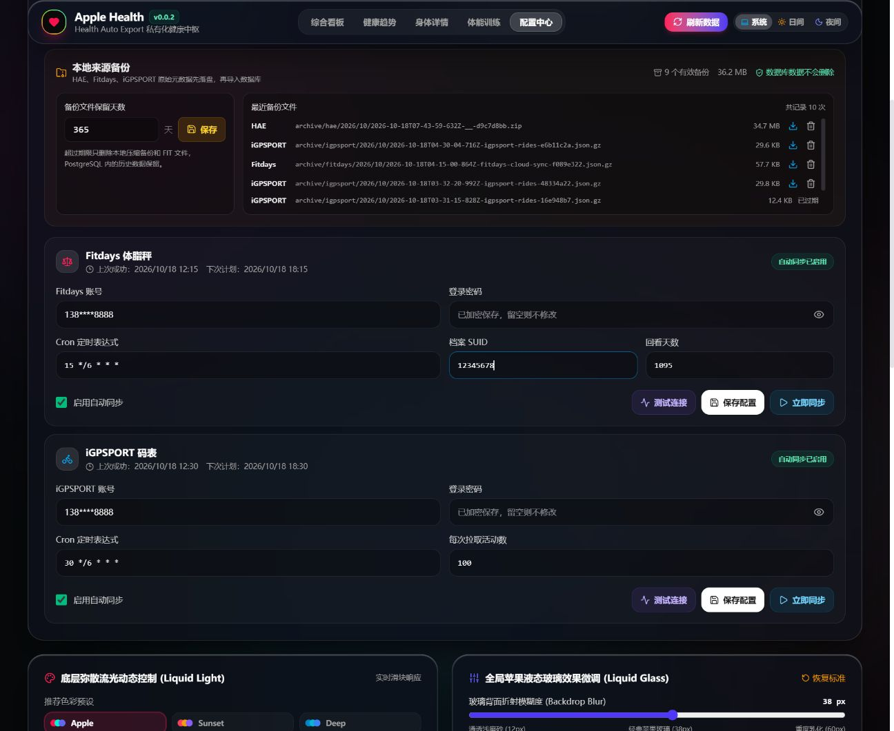
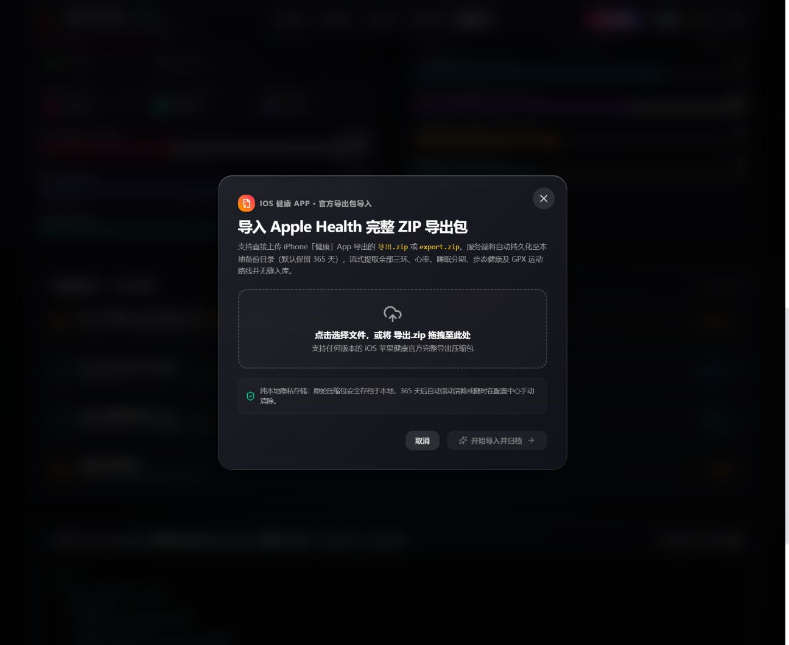

# 🏃 Health Dashboard · 个人私有健康数字中枢

> **“告别数据孤岛与付费云壁垒，让你的心率、体脂与骑行轨迹，100% 真正属于你自己。”**

[](https://hub.docker.com/r/wangheqiang/health-dashboard)
[](LICENSE)
[]()
[]()

一款专为极客、运动爱好者与 NAS 玩家打造的**开源私有化健康数据看板**。完美融合 **Apple Fitness 三环美学** 与 **Grow Bento 风格**，无缝聚合 Apple Watch、Fitdays (沃莱) 智能体脂秤与 iGPSPORT (迹驰) 骑行码表全量时序数据，实现从采集、解析、图表可视化到物理持久化的全流程闭环。



---

## ✨ 为什么选择 Health Dashboard？

* 🍏 **颜值即正义 · 原生 Apple 级交互**  
  深度还原 Apple Fitness 经典三色健身圆环合盖动画、身体状态能量电池（0-100分）、24小时全天心率流光曲线，以及支持躯干与四肢 5 大节段解剖透视的 8 电极体成分分析。
* 💾 **全要素纯本地持久化 · NAS 深度友好**  
  摒弃难以管理的 Docker 内部匿名卷，**数据库实体文件、运行日志、每日自动压缩 SQL 冷备、采集原始流通通落盘在宿主机本地 `./data` 目录**。在群晖/威联通/Unraid 上不仅一眼可见，更支持直接文件级冷备迁移。
* 🚀 **超轻量流式解包引擎 · 轻松吞吐 G 级大包**  
  很多健康面板在导入 iPhone 官方“导出健康数据.zip”（常常解压出 800MB+ 的 XML）时容易 OOM 崩溃。本项目自研流式事件解析器，几秒内静默消化数百万行健康记录，内存占用极度克制。
* 🔄 **多端静默汇流 · 告别手动记账**  
  * **iOS 健康**：支持 Health Auto Export 自动化 Webhook 实时接收，支持全量官方 ZIP 拖拽导入；
  * **Fitdays 智能体脂秤**：云端静默抓取，保留 8 维指标、BMI 以及 5 节段解剖肌脂分布；
  * **iGPSPORT 码表**：骑行活动自动同步，不仅有里程、时速、爬升、踏频与心率区间，还自动归档原汁原味的 `.fit` 轨迹源文件。
* 🔒 **隐私至上 · 100% 数据主权**  
  没有第三方埋点，没有厂商云端分析，所有外部同步密码均通过 **AES-256-GCM** 加密后保存在你自己的本地数据库中。

---

## ⚡ 1 分钟极速启动 (Docker Compose)

无需克隆庞大仓库，只需准备一个干净的目录与一个 `docker-compose.yml`，即可一键启动：

```yaml
name: health-dashboard

services:
  db:
    image: postgres:16-alpine
    container_name: health-dashboard-db
    restart: unless-stopped
    ports:
      - "5433:5432"
    environment:
      POSTGRES_DB: health_dashboard
      POSTGRES_USER: health
      POSTGRES_PASSWORD: "YourStrongPassword2026!" # 数据库密码（建议纯字母数字）
      TZ: Asia/Shanghai
    volumes:
      - ./data/postgres:/var/lib/postgresql/data   # 数据库物理文件直接存放在 NAS/本地目录
    healthcheck:
      test: ["CMD-SHELL", "pg_isready -U health -d health_dashboard"]
      interval: 5s
      timeout: 5s
      retries: 20
    logging:
      driver: "json-file"
      options:
        max-size: "10m"
        max-file: "3"

  app:
    image: wangheqiang/health-dashboard:0.0.4
    container_name: health-dashboard-app
    restart: unless-stopped
    init: true
    depends_on:
      db:
        condition: service_healthy
    environment:
      DATABASE_URL: postgresql://health:YourStrongPassword2026!@db:5432/health_dashboard
      APP_ENCRYPTION_KEY: efae74cfab1ed18c2473d39f62475a898e59b6b05d0ed69d07dbab4b657e1f0a # 64位十六进制密钥
      PUBLIC_BASE_URL: ""
      TZ: Asia/Shanghai
      LOG_LEVEL: info
      MAX_HAE_BYTES: 268435456     # 单次上传允许最大字节（默认 256MB，ZIP 导入支持 500MB）
      BACKUP_RETENTION_DAYS: 365   # 归档及备份保留天数（默认 365 天）
    ports:
      - "8443:8080"
    volumes:
      - ./data:/app/data           # 日志、冷备、原始文件全部持久化在本地
    healthcheck:
      test: ["CMD", "node", "-e", "fetch('http://127.0.0.1:8080/api/health').then(r=>{if(!r.ok)process.exit(1)}).catch(()=>process.exit(1))"]
      interval: 15s
      timeout: 5s
      retries: 10
    logging:
      driver: "json-file"
      options:
        max-size: "10m"
        max-file: "3"
```

### 启动服务

```bash
docker compose up -d
```

启动完成后，打开浏览器访问：`http://<NAS或服务器IP>:8443`，立即体验！

---

## 📂 本地持久化文件全景 (NAS Directory Structure)

项目所有的运行时核心状态、数据库实体、日常抓包流与历史备份都规整地落在本地 `./data` 目录下，结构一目了然：

```text
./data/
├── postgres/        # PostgreSQL 数据库物理文件（数据表、索引、WAL 日志，换机直接拷贝走）
├── logs/            # 应用运行日志与错误输出（app.log，自带 10MB 自动轮转防护）
├── backups/         # 数据库定时 SQL 快照（每日 03:15 自动生成 .sql.gz 冷备）
├── archive/         # 各数据源抓取到的原始数据报文（默认保留 365 天滚动清理）
│   ├── hae/         # iOS 导入的原始 JSON/ZIP
│   ├── fitdays/     # 沃莱云端每次拉取的原始 JSON.gz
│   └── igpsport/    # 码表原始活动报文与 .fit 轨迹原件
└── temp_unzip/      # 大包解析临时解压池（解析完毕即刻自动清理，零空间残留）
```

---

## 📱 数据源接入指引

系统启动后，在右上角进入 **设置中心 (Settings)** 即可直观配置各数据源：

### 1. iOS 苹果健康
* **自动化无感上报**：在 iPhone 安装 *Health Auto Export* App，设置 REST API Webhook 地址为 `http://<你的IP>:8443/api/v1/hae/webhook`，填入面板生成的专属 API Key，每晚即可自动静默上报；
* **历史全量导入**：在 iPhone“健康”App 点击右上角头像 ➔“导出所有健康数据”➔ 将生成的 `导出.zip` 在看板设置页直接点击“导入苹果健康 ZIP 包”，数秒即可完整回溯多年历史！

### 2. Fitdays (沃莱) 智能体脂秤
* 填入 Fitdays App 的账号与密码，系统内嵌 AES 加密保护；
* 默认每 6 小时自动查询一次最新称重记录，支持立即测试连接并全量拉取。

### 3. iGPSPORT (迹驰) 骑行码表
* 填入 iGPSPORT 账号密码，定时静默抓取最新骑行活动；
* 自动下载活动对应的原始 `.fit` 轨迹并结构化提取功率、踏频、心率区间与海拔高度。

---

## 🛠️ 进阶管理与脚本工具

项目内置开箱即用的运维脚本，可以在容器内或本地终端中随时使用：

```bash
# 立即手动执行一次数据库完整快照（生成压缩 .sql.gz 至 ./data/backups/）
docker exec health-dashboard-app pnpm backup:db

# 实时查看后端运行日志
docker compose logs -f app

# 也可以直接在宿主机打开日志文件实时排查
tail -f ./data/logs/app.log
```

---

## 💡 常见问题 (FAQ)

* **Q：复杂密码包含特殊字符怎么办？**  
  A：在 `docker-compose.yml` 或 `.env` 中用双引号包裹（如 `POSTGRES_PASSWORD: "MyPassword2026!"`）。如果密码中包含 `$`，需写成 `$$` 转义，连接串中若含有 `@` 或 `:` 请注意做 URL 编码；最推荐使用 32 位以上的纯字母数字随机字符串，高强度且零语法冲突。
* **Q：在 NAS 上怎么对外暴露？**  
  A：支持反向代理（Nginx Proxy Manager / Traefik / 群晖内置反代）。将域名或子路径反代至容器的 `8443` 端口即可，可开启 HTTPS。

---

## 🤝 参与贡献

欢迎提交 Issue 或 Pull Request！未来规划支持 Garmin、Keep、迈金 (Magene) 等更多运动健康设备生态接入。如果你喜欢这个项目，欢迎点一颗 ⭐️ Star 支持！

**MIT License © 2026 wangheqiang**

### 5. 配置中心与数据管道 (Config Center)
配置中心提供完整的后端管理与个性化控制：
- **官方导出 ZIP 一键导入**：直接上传 iPhone「健康」App 导出的 `导出.zip`，流式解析数百 MB XML 并将压缩包存档至本地（默认保留 365 天）。
- **Health Auto Export 自动化 Webhook**：提供局域网 REST URL 与密钥，支持自动推送。
- **Fitdays & iGPSPORT 定时同步**：配置 Cron 定时器，凭据 AES-256-GCM 密文入库，支持测试连通性与立即同步。
- **本地来源备份管理**：默认 365 天滚动清除，支持随时调整保留期、下载备份包或单项手动删除。
- **苹果液态玻璃与弥散流光动态调节**：实时拖动滑块自定义底色流光速度、模糊半径、玻璃饱和度与高光反射。





---

## 快速开始

### 方式一：Docker Compose 单文件免 .env 运行 (最推荐 NAS / 群晖 / 威联通 / Unraid)

在 NAS 上的任意目录（如 `/volume1/docker/health-dashboard`）创建 `docker-compose.yml`，粘贴以下内容（配置已直接写入，**无需任何 .env 文件**）：

```yaml
name: health-dashboard

services:
  db:
    image: postgres:16-alpine
    container_name: health-dashboard-db
    restart: unless-stopped
    ports:
      - "5433:5432"
    environment:
      POSTGRES_DB: health_dashboard
      POSTGRES_USER: health
      POSTGRES_PASSWORD: HealthSecretPassword2026!
      TZ: Asia/Shanghai
    volumes:
      - health_pgdata:/var/lib/postgresql/data
    healthcheck:
      test: ["CMD-SHELL", "pg_isready -U health -d health_dashboard"]
      interval: 5s
      timeout: 5s
      retries: 20

  app:
    image: wangheqiang/health-dashboard:0.0.2
    container_name: health-dashboard-app
    restart: unless-stopped
    init: true
    depends_on:
      db:
        condition: service_healthy
    environment:
      DATABASE_URL: postgresql://health:HealthSecretPassword2026!@db:5432/health_dashboard
      APP_ENCRYPTION_KEY: efae74cfab1ed18c2473d39f62475a898e59b6b05d0ed69d07dbab4b657e1f0a
      PUBLIC_BASE_URL: ""
      TZ: Asia/Shanghai
      LOG_LEVEL: info
      MAX_HAE_BYTES: 268435456
      BACKUP_RETENTION_DAYS: 365
      APP_VERSION: 0.0.2
      DOCKERHUB_REPOSITORY: wangheqiang/health-dashboard
      GITHUB_REPOSITORY: wangheqiang530/health-dashboard
    ports:
      - "8443:8080"
    volumes:
      - ./data:/app/data
    healthcheck:
      test: ["CMD", "node", "-e", "fetch('http://127.0.0.1:8080/api/health').then(r=>{if(!r.ok)process.exit(1)}).catch(()=>process.exit(1))"]
      interval: 15s
      timeout: 5s
      retries: 10

volumes:
  health_pgdata:
```

在同级目录下执行启动（群晖 Container Manager / Portainer 用户直接在图形界面粘贴保存并启动）：

```bash
docker compose up -d
```

4. 打开浏览器访问：

```text
http://localhost:8443
```

> **提示**：初次启动时数据库默认是 0 数据的干净状态，页面将引导前往「配置中心」导入健康数据或连接数据源。

---

### 方式二：源码本地开发

```bash
# 1. 安装依赖 (Node.js >= 22)
pnpm install

# 2. 启动开发环境
pnpm dev:api   # 启动后端 API (默认 8080)
pnpm dev       # 启动 Vite 前端开发服务器 (默认 5173)

# 3. 生产打包与语法检查
pnpm build
pnpm lint
```

---

## 数据导入与源配置指南

### 1. iOS 健康 App 官方压缩包 (`导出.zip`)
1. 打开 iPhone 上的「健康」App，点击右上角个人头像。
2. 滑动到最下方，点击 **导出所有健康数据**，等待 iPhone 打包完成并生成 `导出.zip`。
3. 将 `导出.zip` 发送至电脑端。
4. 打开大屏 **配置中心 ➔ 导入 iOS 健康 App 官方导出包 (.zip)**，拖入文件点击开始导入。
5. 系统将自动保存压缩包至本地备份目录（保留 365 天），并在数秒内完成数百 MB XML 数据流式入库。

### 2. Health Auto Export 实时自动推送 (Webhook)
1. 在 iPhone 安装并打开 **Health Auto Export** App。
2. 进入「Automations」页面，添加 REST API 导出任务。
3. 从配置中心复制对应的 `REST API URL`（例如 `http://192.168.1.100:8443/api/v1/health-auto-export`）与 `X-Api-Key`。
4. 勾选需要导出的所有指标与 Workouts，开启每日后台自动化同步。

### 3. Fitdays 智能体脂秤云端直连
1. 打开配置中心 ➔ **Fitdays 体脂秤** 卡片。
2. 填写注册账号（手机号）与密码。若家庭多用户，可填入主号档案 SUID（留空则自动识别当前活跃档案）。
3. 设定定时拉取 Cron 表达式（默认每 6 小时同步一次：`15 */6 * * *`）。
4. 点击 **保存配置** 并点击 **立即同步**。

### 4. iGPSPORT 骑行码表全量活动直连
1. 打开配置中心 ➔ **iGPSPORT 码表** 卡片。
2. 填写 iGPSPORT 登录手机号与密码。
3. 设定每次拉取活动数量（例如 `100`）及 Cron 定时表达式。
4. 点击 **立即同步**，系统将自动拉取所有骑行记录、踏频、功率及海拔，并自动下载归档原始 `.fit` 文件。

如果浏览器当前使用 `localhost` 打开页面，复制出的 URL 不能从 iPhone 访问。请改用电脑的局域网 IP 打开网页，例如：

```text
http://192.168.1.20:8443
---

## 环境变量说明 (`.env`)

| 环境变量 | 默认值 | 说明 |
| :--- | :--- | :--- |
| `POSTGRES_PASSWORD` | - | PostgreSQL 数据库连接强密码 |
| `POSTGRES_PORT` | `5433` | PostgreSQL 宿主机暴露端口（供外部 AI、Dify 或客户端直连） |
| `APP_ENCRYPTION_KEY` | - | 32 字节随机 Hex 秘钥，用于加密存储数据源密码与 Webhook API Key |
| `DASHBOARD_PORT` | `8443` | 宿主机 Web 访问端口 |
| `APP_VERSION` | `0.0.2` | 当前发布的容器镜像版本号 |
| `BACKUP_RETENTION_DAYS` | `365` | 本地原始备份（ZIP / gzip / FIT）滚动保留天数（默认 1 年） |
| `MAX_HAE_BYTES` | `268435456` | 请求体积上限 (256MB)，满足超大型健康导出包上传 |
| `TZ` | `Asia/Shanghai` | 系统与 Cron 调度时区 |
| `CONTAINER_HTTP_PROXY` | - | 容器内部外部同步请求的 HTTP 代理 (例如 `http://host.docker.internal:10808`) |
| `CONTAINER_HTTPS_PROXY` | - | 容器内部外部同步请求的 HTTPS 代理 |

---

## 外部调用与 AI / Agent 接入指南

本项目自带完善的 API 与标准化数据库，非常适合与本地或云端 AI（如 Dify、FastGPT、OpenAI Function Calling、n8n、Home Assistant 等）联动，实现个性化智能健康管家与自然语言查询。

### 方式一：通过 REST API 接入（推荐，最适合 AI Agent 与自动化工作流）

无需理解复杂的底层数据库表结构，直接请求清洗聚合好的 JSON 数据接口：

```http
# 获取当日全维度健康档案（三环、身体状态、心率、睡眠、体脂、运动明细）
GET http://<NAS_IP>:8443/api/v1/dashboard

# 按指定时间段过滤数据
GET http://<NAS_IP>:8443/api/v1/dashboard?from=2026-10-01&to=2026-10-18
```

**场景示例**：在 Dify / FastGPT 中添加 HTTP 工具，挂载该 API，即可让大模型轻松回答：“分析我最近一周的睡眠深度与心率负荷”、“我本周骑行与力量训练的卡路里总消耗是多少并给出补剂建议”。

### 方式二：直接连接 PostgreSQL 数据库（适合数据分析、Metabase、Python、DBeaver）

默认配置已将 PostgreSQL 映射到宿主机 `5433` 端口（避免与 NAS 自带的 5432 冲突）：

- **主机 (Host)**：`NAS的局域网IP`
- **端口 (Port)**：`5433` (可通过 `.env` 中的 `POSTGRES_PORT` 更改)
- **数据库 (Database)**：`health_dashboard`
- **用户名 (User)**：`health`
- **密码 (Password)**：`.env` 中设置的 `POSTGRES_PASSWORD`

**核心数据表说明**：

| 表名 | 数据内容与用途 | 关键字段 |
| :--- | :--- | :--- |
| `daily_summaries` | 每日综合健康大屏数据（按天聚合的完整 JSONB 字段） | `day`, `summary`, `updated_at` |
| `body_measurements` | Fitdays 8 电极体测历史明细（270+ 项记录） | `measured_date`, `weight_kg`, `bmi`, `body_fat_rate`, `skeletal_muscle_rate`, `visceral_fat_level`, `bmr_kcal`, `bone_mass_kg` |
| `cycling_activities` | 码表骑行活动全记录（里程、踏频、功率、爬升） | `started_at`, `distance_km`, `avg_speed_kmh`, `avg_cadence`, `avg_power`, `ascent_m`, `fit_file_path` |
| `health_workouts` | 苹果健康训练明细（跑步、力量、骑行、游泳等） | `name`, `started_at`, `duration_sec`, `active_energy_kcal`, `avg_heart_rate` |
| `health_metric_points` | 高频生理指标时序采样点（心率、步数、血氧等） | `metric_name`, `recorded_at`, `local_date`, `value` |

---

## 路线图 (Roadmap)

- [x] iOS 健康 App 官方 `导出.zip` 流式解析与本地持久化归档
- [x] Fitdays 沃莱 8 电极体脂秤 8 维指标与 5 节段解剖肌脂分布
- [x] iGPSPORT 码表全量骑行活动、踏频、气压计爬升与原始 `.fit` 归档
- [x] 全页面历史任意日期日历选择与全屏数据联动
- [x] 交互折线图垂直十字探针与悬停数据标注
- [x] 备份文件 365 天自动滚动清除与单项手动清理
- [ ] Strava / Garmin 码表云端直连适配
- [ ] 导出 PDF 格式的体检与体态报告

---

## 安全与隐私说明

- **无外泄风险**：所有个人体征指标与运动轨迹仅存储于您自己的 PostgreSQL 数据库和本地归档目录。
- **敏感凭据加密**：三方数据源密码与 Webhook API Key 使用 `AES-256-GCM` 硬件级强加密落盘。
- **开源安全发布**：发布版本默认 0 数据，不含任何内置账号密码或演示测试数据。

---

## 开源协议

本项目采用 [MIT License](LICENSE) 协议开源。
