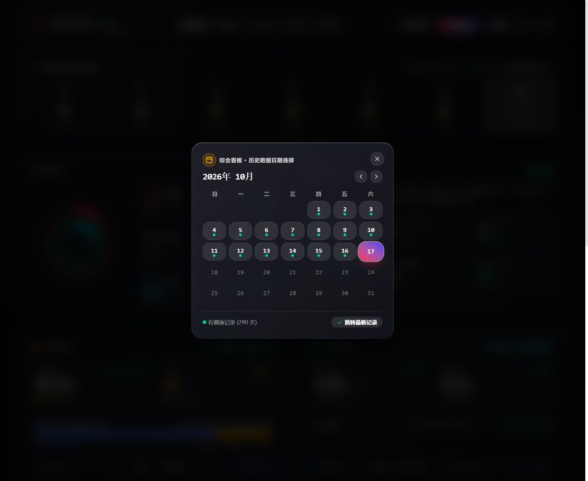
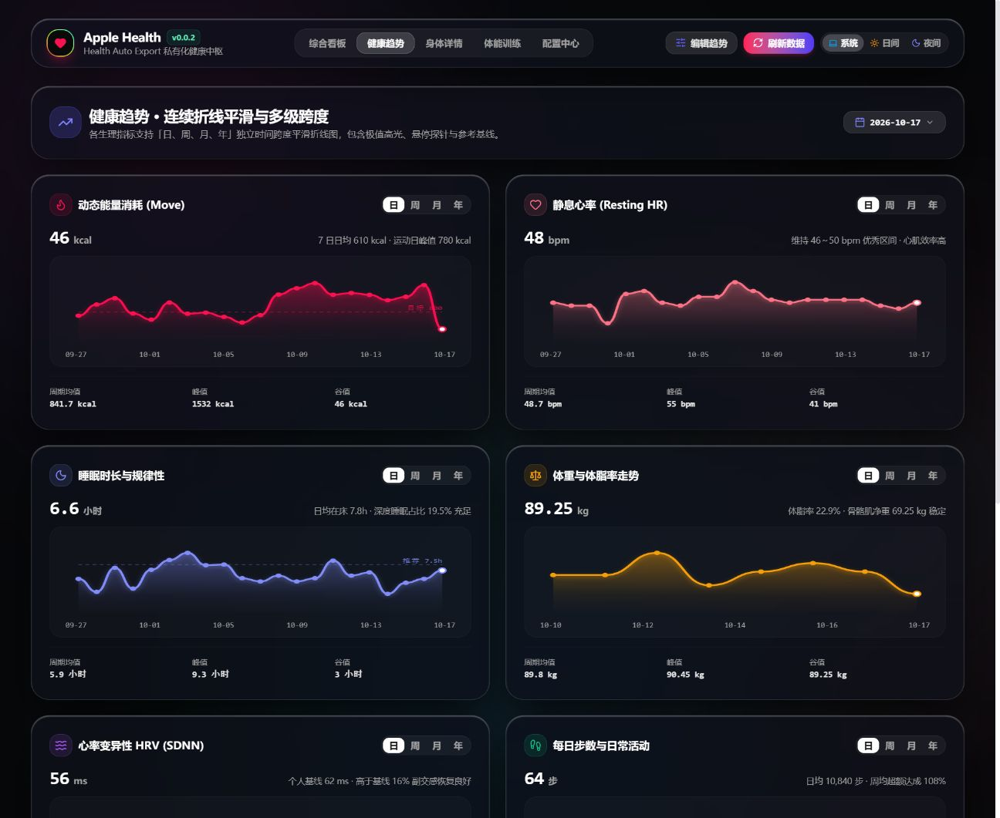
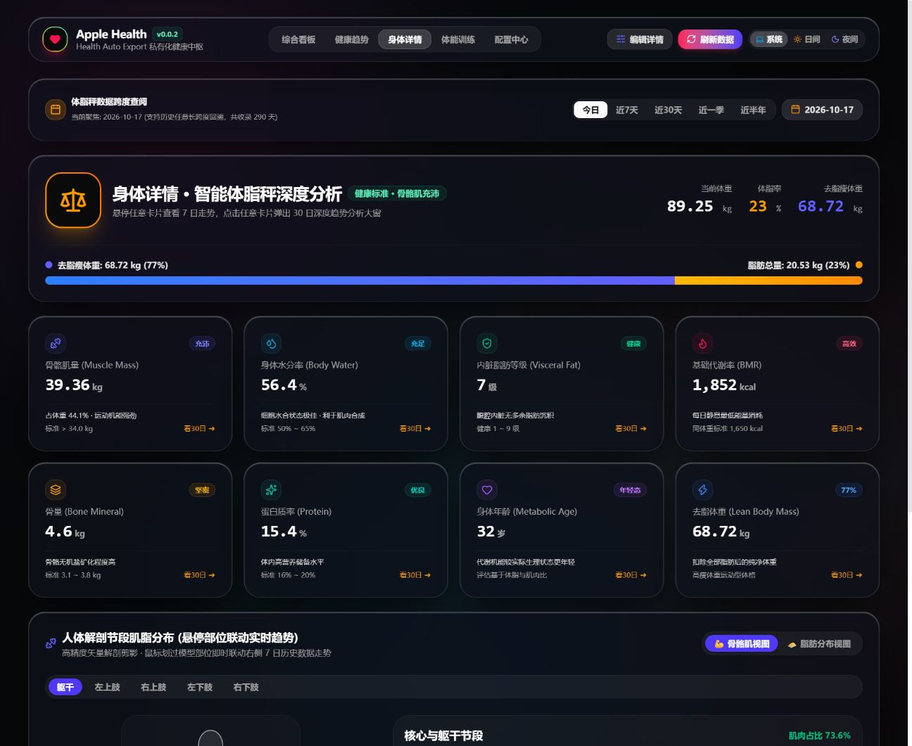
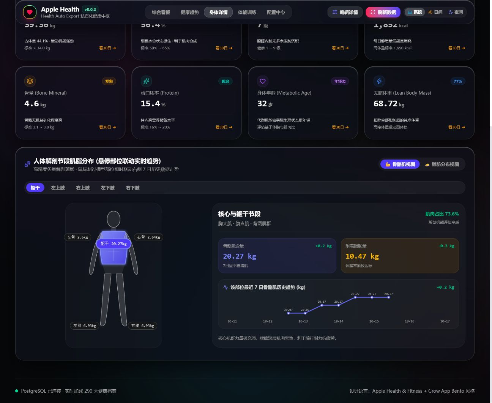
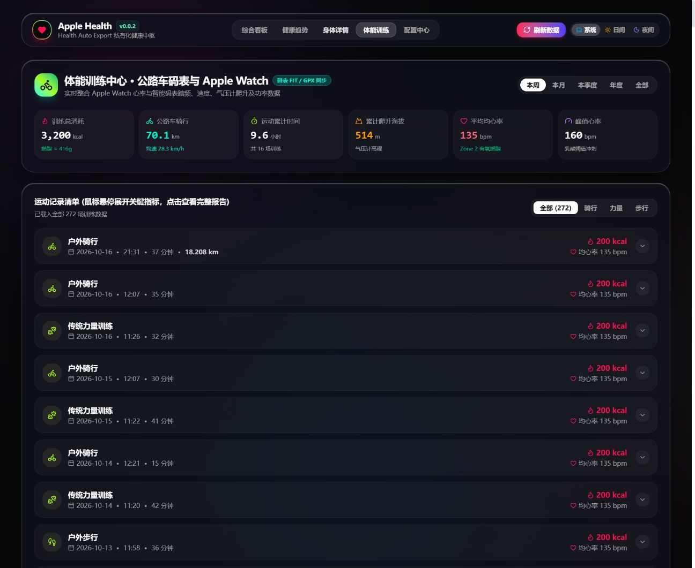

# Apple Health × Grow · 私有化健康数字中枢

基于 Apple Health 与 Grow App Bento 风格设计的全功能个人健康数据中枢与大屏看板。将 iPhone 苹果健康、Apple Watch 体征监测、Fitdays (沃莱) 智能体脂秤与 iGPSPORT (迹驰) 骑行码表无缝接入私有化数据库，支持自动化 Webhook 接收、云端定时拉取、官方压缩包导入与本地滚动持久化归档。

当前版本：**v0.0.2**

- 仓库地址：<https://github.com/wangheqiang530/health-dashboard>
- 预构建镜像：`wangheqiang/health-dashboard:0.0.2` (Docker Hub)

## 架构

---

## 项目架构与设计理念

```text
┌─────────────────────────────────┐
│           多来源健康数据        │
│  · iOS 健康 App 导出.zip (官方包)│
│  · Health Auto Export (Webhook) │
│  · Fitdays 智能体脂秤 (云端 API)│
│  · iGPSPORT 骑行码表 (云端 API) │
└────────────────┬────────────────┘
                 │
                 ▼
┌─────────────────────────────────┐      ┌─────────────────────────┐
│     Fastify 全功能 API 管道     │ ───► │  本地来源持久化备份     │
│  · AES-256-GCM 凭据加密入库     │      │  · 原始 ZIP / gzip 归档 │
│  · node-cron 进程内无死锁调度器 │      │  · 默认 365 天滚动清除  │
│  · 784MB XML 流式高性能解析器   │      │  · 支持手动下载与单项清理│
└────────────────┬────────────────┘      └─────────────────────────┘
                 │
                 ▼
┌─────────────────────────────────┐
│         PostgreSQL 16           │
│  · 每日聚合看板 (daily_summaries)│
│  · 8 维体测记录 (body_measure)  │
│  · 码表骑行活动 (cycling_activ) │
│  · 运动训练与心率时序点         │
└────────────────┬────────────────┘
                 │
                 ▼
┌─────────────────────────────────┐
│     React + Tailwind 前端大屏   │
│  · 5 大专用视图与 100% 真实数据 │
│  · 苹果液态玻璃与弥散流光动态   │
│  · 纯本地部署，默认 0 隐私数据  │
└─────────────────────────────────┘
```

- **纯私有化、零隐私泄露**：项目在 Docker 容器与局域网内运行，初始部署默认 0 数据，不包含任何个人隐私凭据。
- **全格式兼容**：同时支持 iOS 健康 App 官方压缩包 (`导出.zip`)、Health Auto Export 自动化 Webhook、Fitdays 智能体脂秤云端 API 与 iGPSPORT 码表活动 / `.fit` 文件。
- **三层存储保障**：原始数据先落盘归档（默认保留 365 天）➔ 核心时序指标标准化入库 ➔ 每日聚合大屏秒级响应。

---

## 核心功能与大屏效果

### 1. 综合看板 (Overview)
深度还原 Apple Fitness 三色圆环（动态能量 / 锻炼时长 / 站立小时），配以 Grow 风格身体状态能量电池（0-100 分）、24 小时心率波动时间线、双足支撑与步态健康、睡眠分期、感官环境音量以及全屏日期快速切换。


#### 全历史日期日历选择
顶部的健身圆环合盖记录栏提供全局日历选择弹窗，可无缝回溯全量收录的任意历史日期，即时联动全屏三环、体征与各项卡片：



---

### 2. 健康趋势 (Trends)
各生理指标（动态能量消耗、静息心率、睡眠时长、体重体脂、HRV 变异性、每日步数、VO2 Max 最大摄氧量、呼吸扰动指数）均支持日、周、月、年独立时间跨度。
- **交互十字探针**：鼠标滑过折线图时，高光垂直虚线贯穿波形，实时吸附游标并显示准确数据值与日期浮标。
- **动态聚合**：周与月跨度根据数据库内真实历史自动汇总总消耗与周期均值。



---

### 3. 身体详情与解剖节段分布 (Body Details)
全面打通 Fitdays 8 电极体脂秤的高精度身体成分数据：
- **8 维核心指标**：骨骼肌量、身体水分率、内脏脂肪等级、基础代谢率 (BMR)、骨量、蛋白质率、身体年龄、去脂净重，支持悬停查看 7 日微走势，点击弹出 30 日深度医学趋势大窗。
- **5 节段解剖肌脂分布**：支持**躯干、左上肢、右上肢、左下肢、右下肢**共五大节段独立切换，模型悬停高亮联动右侧 7 日肌肉与脂肪演变走势。
- **无遮挡月份日历**：顶部日历选择器已采用全屏弹窗重构，彻底解决层叠样式遮挡问题。





---

### 4. 体能训练中心 (Workouts)
汇聚 Apple Watch 体能训练与 iGPSPORT 公路车码表所有运动记录。
- **动态全周期统计**：切换“本周 / 本月 / 本季度 / 年度 / 全部”时，根据真实记录精准统计总消耗、骑行里程、累计爬升海拔与平均心率。
- **运动清单与展开抽屉**：单项运动鼠标悬停即可展开踏频、峰值心率、心率区间占比与配速，点击可打开包含区间分布与关键指标的完整体能报告。



---

### 5. 配置中心与数据管道 (Config Center)
配置中心提供完整的后端管理与个性化控制：
- **官方导出 ZIP 一键导入**：直接上传 iPhone「健康」App 导出的 `导出.zip`，流式解析数百 MB XML 并将压缩包存档至本地（默认保留 365 天）。
- **Health Auto Export 自动化 Webhook**：提供局域网 REST URL 与密钥，支持自动推送。
- **Fitdays & iGPSPORT 定时同步**：配置 Cron 定时器，凭据 AES-256-GCM 密文入库，支持测试连通性与立即同步。
- **本地来源备份管理**：默认 365 天滚动清除，支持随时调整保留期、下载备份包或单项手动删除。
- **苹果液态玻璃与弥散流光动态调节**：实时拖动滑块自定义底色流光速度、模糊半径、玻璃饱和度与高光反射。


---

## 快速开始

### 方式一：Docker Compose 单文件免 .env 运行 (最推荐 NAS / 群晖 / 威联通 / Unraid)

在 NAS 上的任意目录（如 `/volume1/docker/health-dashboard`）创建 `docker-compose.yml`，粘贴以下内容（配置已直接写入，**无需任何 .env 文件**）：

```yaml
name: health-dashboard

services:
  db:
    image: postgres:16-alpine
    container_name: health-dashboard-db
    restart: unless-stopped
    ports:
      - "5433:5432"
    environment:
      POSTGRES_DB: health_dashboard
      POSTGRES_USER: health
      POSTGRES_PASSWORD: HealthSecretPassword2026!
      TZ: Asia/Shanghai
    volumes:
      - health_pgdata:/var/lib/postgresql/data
    healthcheck:
      test: ["CMD-SHELL", "pg_isready -U health -d health_dashboard"]
      interval: 5s
      timeout: 5s
      retries: 20

  app:
    image: wangheqiang/health-dashboard:0.0.2
    container_name: health-dashboard-app
    restart: unless-stopped
    init: true
    depends_on:
      db:
        condition: service_healthy
    environment:
      DATABASE_URL: postgresql://health:HealthSecretPassword2026!@db:5432/health_dashboard
      APP_ENCRYPTION_KEY: efae74cfab1ed18c2473d39f62475a898e59b6b05d0ed69d07dbab4b657e1f0a
      PUBLIC_BASE_URL: ""
      TZ: Asia/Shanghai
      LOG_LEVEL: info
      MAX_HAE_BYTES: 268435456
      BACKUP_RETENTION_DAYS: 365
      APP_VERSION: 0.0.2
      DOCKERHUB_REPOSITORY: wangheqiang/health-dashboard
      GITHUB_REPOSITORY: wangheqiang530/health-dashboard
    ports:
      - "8443:8080"
    volumes:
      - ./data:/app/data
    healthcheck:
      test: ["CMD", "node", "-e", "fetch('http://127.0.0.1:8080/api/health').then(r=>{if(!r.ok)process.exit(1)}).catch(()=>process.exit(1))"]
      interval: 15s
      timeout: 5s
      retries: 10

volumes:
  health_pgdata:
```

在同级目录下执行启动（群晖 Container Manager / Portainer 用户直接在图形界面粘贴保存并启动）：

```bash
docker compose up -d
```

4. 打开浏览器访问：

```text
http://localhost:8443
```

> **提示**：初次启动时数据库默认是 0 数据的干净状态，页面将引导前往「配置中心」导入健康数据或连接数据源。

---

### 方式二：源码本地开发

```bash
# 1. 安装依赖 (Node.js >= 22)
pnpm install

# 2. 启动开发环境
pnpm dev:api   # 启动后端 API (默认 8080)
pnpm dev       # 启动 Vite 前端开发服务器 (默认 5173)

# 3. 生产打包与语法检查
pnpm build
pnpm lint
```

---

## 数据导入与源配置指南

### 1. iOS 健康 App 官方压缩包 (`导出.zip`)
1. 打开 iPhone 上的「健康」App，点击右上角个人头像。
2. 滑动到最下方，点击 **导出所有健康数据**，等待 iPhone 打包完成并生成 `导出.zip`。
3. 将 `导出.zip` 发送至电脑端。
4. 打开大屏 **配置中心 ➔ 导入 iOS 健康 App 官方导出包 (.zip)**，拖入文件点击开始导入。
5. 系统将自动保存压缩包至本地备份目录（保留 365 天），并在数秒内完成数百 MB XML 数据流式入库。

### 2. Health Auto Export 实时自动推送 (Webhook)
1. 在 iPhone 安装并打开 **Health Auto Export** App。
2. 进入「Automations」页面，添加 REST API 导出任务。
3. 从配置中心复制对应的 `REST API URL`（例如 `http://192.168.1.100:8443/api/v1/health-auto-export`）与 `X-Api-Key`。
4. 勾选需要导出的所有指标与 Workouts，开启每日后台自动化同步。

### 3. Fitdays 智能体脂秤云端直连
1. 打开配置中心 ➔ **Fitdays 体脂秤** 卡片。
2. 填写注册账号（手机号）与密码。若家庭多用户，可填入主号档案 SUID（留空则自动识别当前活跃档案）。
3. 设定定时拉取 Cron 表达式（默认每 6 小时同步一次：`15 */6 * * *`）。
4. 点击 **保存配置** 并点击 **立即同步**。

### 4. iGPSPORT 骑行码表全量活动直连
1. 打开配置中心 ➔ **iGPSPORT 码表** 卡片。
2. 填写 iGPSPORT 登录手机号与密码。
3. 设定每次拉取活动数量（例如 `100`）及 Cron 定时表达式。
4. 点击 **立即同步**，系统将自动拉取所有骑行记录、踏频、功率及海拔，并自动下载归档原始 `.fit` 文件。

如果浏览器当前使用 `localhost` 打开页面，复制出的 URL 不能从 iPhone 访问。请改用电脑的局域网 IP 打开网页，例如：

```text
http://192.168.1.20:8443
---

## 环境变量说明 (`.env`)

| 环境变量 | 默认值 | 说明 |
| :--- | :--- | :--- |
| `POSTGRES_PASSWORD` | - | PostgreSQL 数据库连接强密码 |
| `POSTGRES_PORT` | `5433` | PostgreSQL 宿主机暴露端口（供外部 AI、Dify 或客户端直连） |
| `APP_ENCRYPTION_KEY` | - | 32 字节随机 Hex 秘钥，用于加密存储数据源密码与 Webhook API Key |
| `DASHBOARD_PORT` | `8443` | 宿主机 Web 访问端口 |
| `APP_VERSION` | `0.0.2` | 当前发布的容器镜像版本号 |
| `BACKUP_RETENTION_DAYS` | `365` | 本地原始备份（ZIP / gzip / FIT）滚动保留天数（默认 1 年） |
| `MAX_HAE_BYTES` | `268435456` | 请求体积上限 (256MB)，满足超大型健康导出包上传 |
| `TZ` | `Asia/Shanghai` | 系统与 Cron 调度时区 |
| `CONTAINER_HTTP_PROXY` | - | 容器内部外部同步请求的 HTTP 代理 (例如 `http://host.docker.internal:10808`) |
| `CONTAINER_HTTPS_PROXY` | - | 容器内部外部同步请求的 HTTPS 代理 |

---

## 外部调用与 AI / Agent 接入指南

本项目自带完善的 API 与标准化数据库，非常适合与本地或云端 AI（如 Dify、FastGPT、OpenAI Function Calling、n8n、Home Assistant 等）联动，实现个性化智能健康管家与自然语言查询。

### 方式一：通过 REST API 接入（推荐，最适合 AI Agent 与自动化工作流）

无需理解复杂的底层数据库表结构，直接请求清洗聚合好的 JSON 数据接口：

```http
# 获取当日全维度健康档案（三环、身体状态、心率、睡眠、体脂、运动明细）
GET http://<NAS_IP>:8443/api/v1/dashboard

# 按指定时间段过滤数据
GET http://<NAS_IP>:8443/api/v1/dashboard?from=2026-10-01&to=2026-10-18
```

**场景示例**：在 Dify / FastGPT 中添加 HTTP 工具，挂载该 API，即可让大模型轻松回答：“分析我最近一周的睡眠深度与心率负荷”、“我本周骑行与力量训练的卡路里总消耗是多少并给出补剂建议”。

### 方式二：直接连接 PostgreSQL 数据库（适合数据分析、Metabase、Python、DBeaver）

默认配置已将 PostgreSQL 映射到宿主机 `5433` 端口（避免与 NAS 自带的 5432 冲突）：

- **主机 (Host)**：`NAS的局域网IP`
- **端口 (Port)**：`5433` (可通过 `.env` 中的 `POSTGRES_PORT` 更改)
- **数据库 (Database)**：`health_dashboard`
- **用户名 (User)**：`health`
- **密码 (Password)**：`.env` 中设置的 `POSTGRES_PASSWORD`

**核心数据表说明**：

| 表名 | 数据内容与用途 | 关键字段 |
| :--- | :--- | :--- |
| `daily_summaries` | 每日综合健康大屏数据（按天聚合的完整 JSONB 字段） | `day`, `summary`, `updated_at` |
| `body_measurements` | Fitdays 8 电极体测历史明细（270+ 项记录） | `measured_date`, `weight_kg`, `bmi`, `body_fat_rate`, `skeletal_muscle_rate`, `visceral_fat_level`, `bmr_kcal`, `bone_mass_kg` |
| `cycling_activities` | 码表骑行活动全记录（里程、踏频、功率、爬升） | `started_at`, `distance_km`, `avg_speed_kmh`, `avg_cadence`, `avg_power`, `ascent_m`, `fit_file_path` |
| `health_workouts` | 苹果健康训练明细（跑步、力量、骑行、游泳等） | `name`, `started_at`, `duration_sec`, `active_energy_kcal`, `avg_heart_rate` |
| `health_metric_points` | 高频生理指标时序采样点（心率、步数、血氧等） | `metric_name`, `recorded_at`, `local_date`, `value` |

---

## 路线图 (Roadmap)

- [x] iOS 健康 App 官方 `导出.zip` 流式解析与本地持久化归档
- [x] Fitdays 沃莱 8 电极体脂秤 8 维指标与 5 节段解剖肌脂分布
- [x] iGPSPORT 码表全量骑行活动、踏频、气压计爬升与原始 `.fit` 归档
- [x] 全页面历史任意日期日历选择与全屏数据联动
- [x] 交互折线图垂直十字探针与悬停数据标注
- [x] 备份文件 365 天自动滚动清除与单项手动清理
- [ ] Strava / Garmin 码表云端直连适配
- [ ] 导出 PDF 格式的体检与体态报告

---

## 安全与隐私说明

- **无外泄风险**：所有个人体征指标与运动轨迹仅存储于您自己的 PostgreSQL 数据库和本地归档目录。
- **敏感凭据加密**：三方数据源密码与 Webhook API Key 使用 `AES-256-GCM` 硬件级强加密落盘。
- **开源安全发布**：发布版本默认 0 数据，不含任何内置账号密码或演示测试数据。

---

## 开源协议

本项目采用 [MIT License](LICENSE) 协议开源。
